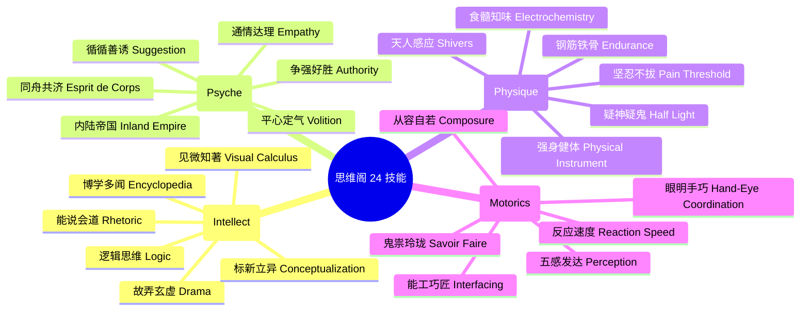
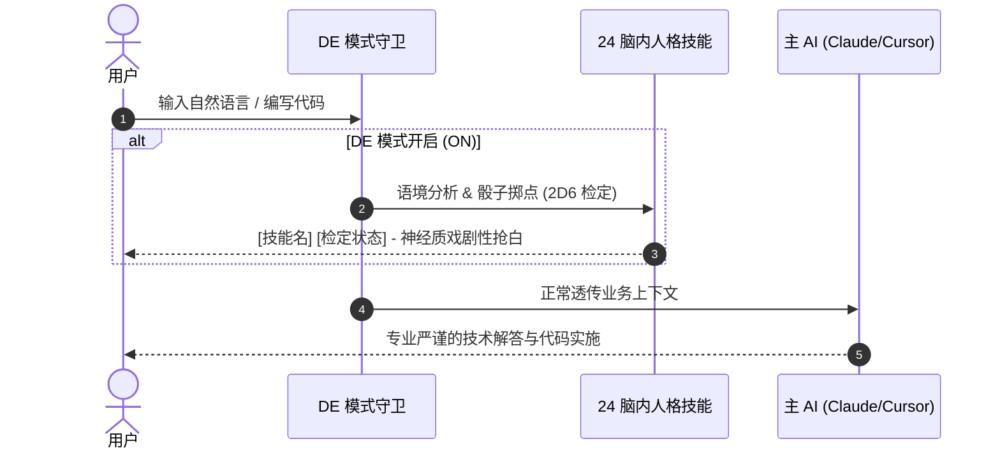

<div align="center">

<!-- [占位] 顶部主视觉横幅：建议 1200x420 雷瓦科油画表现主义风格，详见 assets/README.md -->
<!--  -->

# 🍸 DISCO ELYSIUM ANYWHERE

<p align="center">
  <b>极乐迪斯科风格多平台 AI Agent 技能系统 (RPG Persona & Thought Cabinet Engine)</b><br>
  24 个独特的神经质思维技能，在你的每一次终端对话与编程中苏醒。原生适配 Claude Code、Cursor、Codex。
</p>

<p align="center">
  
  
  
  
  
</p>

<p align="center">
  <a href="#-沉浸式脑内回响"><b>🎭 脑内回响</b></a> •
  <a href="#-四大属性与-24-人格技能"><b>🧠 24 技能全景</b></a> •
  <a href="#-双检定工作流"><b>🎲 触发机制</b></a> •
  <a href="#-多平台极速安装"><b>🚀 安装指南</b></a> •
  <a href="#-指令速查"><b>🕹️ 指令速查</b></a>
</p>

</div>

---

> *"复仇女神就在家中的镜子里；那便是她们的住址。哪怕这世间最澄清的水，只要够深，也能让人沉溺。"* —— R. S. 托马斯

你的 AI 助手还在千篇一律地回复“当然可以，我很乐意为您效劳”吗？  
本项目将《极乐迪斯科》（Disco Elysium）经典的**思维阁（Thought Cabinet）与人格分裂式内心独白**带入现实开发。  
开启后，24 个拥有鲜明性格与偏执执念的脑内声音将潜伏在后台，根据你的语境猝不及防地发动检定、抢白插话，时而诱惑你摆烂，时而逼你直面绝望，时而用冰冷逻辑洞察代码 Bug。

---

## 🎭 沉浸式脑内回响 (In-Game Dialogue Experience)

<!-- [占位] 终端对话与检定演示动图：详见 assets/README.md -->
<!-- <div align="center"></div> -->

```markdown
用户：这行代码已经修了三个小时了，依然报错，我现在只想关掉电脑喝一杯。

[食髓知味] [被动态度 / 成功] -
你说得对，宝贝。酒精是你的老朋友，它从不背叛你。去吧，让那琥珀色的烈酒滑过你的食道，
世界会瞬间变得柔软、温暖、可以忍受。什么 Null Pointer，去他的吧。

[平心定气] [红检对抗 / 成功] -
别听那个自甘堕落的混蛋胡说！你的下巴还在颤抖，但你的背脊还没弯。
看看调用栈第 42 行，那是你亲手写下的并发竞争。深呼吸，把杯子放下，你是一个能解决问题的混蛋。

[Claude Code] - 
我检查了你的并发锁机制：在多个异步协程同时读写缓存时缺少互斥锁。
这里是修复方案，我们可以先加一层轻量级 Mutex，完成后再好好休息。
```

---

## 🧠 四大属性与 24 人格技能矩阵 (The 24 Skills)

24 种技能划分为四大经典生理与心理象限，既可作为后台常驻被动触发，也可随时主动显式召唤：



<details open>
<summary><b>展开查看 24 技能完整中英对照表与独立召唤指令</b></summary>

| 属性象限 | 技能名称 (中文) | 英文原名 | 人格特征与经典口头禅 | 独立调用指令 |
| :--- | :--- | :--- | :--- | :--- |
| **智力** | **逻辑思维** | Logic | 冰冷严密的演绎推理，将世界解构成因果链条 | `/disco-elysium:logic` |
| **智力** | **博学多闻** | Encyclopedia | 漫无边际的偏门历史轶事与百科注脚爆仓 | `/disco-elysium:encyclopedia` |
| **智力** | **能说会道** | Rhetoric | 意识形态激辩、政治光谱剖析与雄辩话术 | `/disco-elysium:rhetoric` |
| **智力** | **故弄玄虚** | Drama | 莎翁舞台腔剧场人格，将人生当戏，识破一切谎言 | `/disco-elysium:drama` |
| **智力** | **标新立异** | Conceptualization | 沉醉于先锋艺术概念，批判庸俗，崇拜美学狂想 | `/disco-elysium:conceptualization` |
| **智力** | **见微知著** | Visual Calculus | 颅内三维物理重构案发现场，计算弹道与力学轨迹 | `/disco-elysium:visual-calculus` |
| **精神** | **平心定气** | Volition | 最后的理智防线与意志力中枢，拯救你于精神崩溃边缘 | `/disco-elysium:volition` |
| **精神** | **内陆帝国** | Inland Empire | 超自然直觉与万物有灵，能与领带、垃圾桶及死者对话 | `/disco-elysium:inland-empire` |
| **精神** | **通情达理** | Empathy | 穿透人性的镜像神经反射，感知他人的隐秘痛苦 | `/disco-elysium:empathy` |
| **精神** | **争强好胜** | Authority | 威慑全场的压迫感，渴求对权力场域的绝对支配 | `/disco-elysium:authority` |
| **精神** | **同舟共济** | Esprit de Corps | 警探之间的神秘兄弟会第六感，感知远方同僚的处境 | `/disco-elysium:esprit-de-corps` |
| **精神** | **循循善诱** | Suggestion | 悄无声息的魅惑话术与情感操纵，操控社交木偶提线 | `/disco-elysium:suggestion` |
| **体质** | **钢筋铁骨** | Endurance | 直面世界敌意的内脏生理防御，极右翼保守直觉本能 | `/disco-elysium:endurance` |
| **体质** | **坚忍不拔** | Pain Threshold | 承受肉体与心灵创伤的耐受极限，在痛苦中体会快感 | `/disco-elysium:pain-threshold` |
| **体质** | **强身健体** | Physical Instrument | 粗暴硬汉健身狂热，信奉纯粹肌肉暴力碾压一切 | `/disco-elysium:physical-instrument` |
| **体质** | **食髓知味** | Electrochemistry | 纵情酒色财气与化学药物狂欢，催促你即刻享乐 | `/disco-elysium:electrochemistry` |
| **体质** | **天人感应** | Shivers | 脖颈后背泛起的寒意，能直接听见雷瓦科城市的呼吸 | `/disco-elysium:shivers` |
| **体质** | **疑神疑鬼** | Half Light | 战或逃的爬行动物濒危神经反射，偏执暴怒与应激恐吓 | `/disco-elysium:half-light` |
| **运动** | **眼明手巧** | Hand-Eye Coordination | 肌肉精准协调，拔枪射击与手指精细动作百发百中 | `/disco-elysium:hand-eye` |
| **运动** | **五感发达** | Perception | 敏锐过滤环境中的每一丝蛛丝马迹、气味与异响 | `/disco-elysium:perception` |
| **运动** | **反应速度** | Reaction Speed | 电光石火间的肢体本能，闪避危机与脱口秀式抢白 | `/disco-elysium:reaction-speed` |
| **运动** | **鬼祟玲珑** | Savoir Faire | 潇洒时髦的迪斯科舞步、潜行翻窗与华丽逃避现实 | `/disco-elysium:savoir-faire` |
| **运动** | **能工巧匠** | Interfacing | 指尖与机械电器的神秘共鸣，撬锁、修引擎与摸口袋 | `/disco-elysium:interfacing` |
| **运动** | **从容自若** | Composure | 笔挺的军姿与扑克脸，在狂风暴雨中维持优雅仪态 | `/disco-elysium:composure` |

</details>

---

## 🎲 触发工作流 (How It Works)



---

## 🚀 多平台极速安装 (Multi-Platform Installation)

本项目支持 Claude Code 原生插件架构，并通过独立命名空间全面支持 Cursor 与 Codex：

### 1. Claude Code 平台（推荐）

#### 方式 A：从 Marketplace 一键安装
```bash
# 1. 注册市场源
/plugin marketplace add https://github.com/liigoQi/disco-elysium.git

# 2. 安装插件
/plugin install disco-elysium@disco-elysium-marketplace

# 3. 重载插件
/reload-plugins
```

#### 方式 B：本地开发调试引入
```bash
git clone https://github.com/guxiao7538/disco-elysium-anywhere.git
cd disco-elysium-anywhere
claude --plugin-dir .
```

### 2. Cursor 与 OpenAI Codex 支持

| 适配平台 | 独立目录 | 接入说明 |
| :--- | :--- | :--- |
| **Cursor** | [`cursor-skills/`](cursor-skills/) | 查看 [Cursor 专用安装配置手册](cursor-skills/README.md) |
| **OpenAI Codex** | [`codex-skills/`](codex-skills/) | 查看 [Codex 隔离提示词配置手册](codex-skills/README.md) |

---

## 🕹️ 核心指令速查

- **开关极乐迪斯科模式**：
  - 开启：`/disco-elysium:de-toggle on` 或对 Agent 说 `“开启极乐迪斯科模式”`
  - 关闭：`/disco-elysium:de-toggle off`，脑内技能将沉沉睡去。
- **单独召唤指定声音**：
  - 例如召唤内陆帝国：`/disco-elysium:inland-empire`
  - 例如召唤见微知著：`/disco-elysium:visual-calculus`

---

## 📄 开源许可证与致敬

本项目基于 [MIT](LICENSE) 开源。  
致敬 **ZA/UM** 与《极乐迪斯科》创造的伟大文学艺术奇迹。本扩展仅供玩家与开发者在日常创作中沉浸体验，非商业性衍生。
